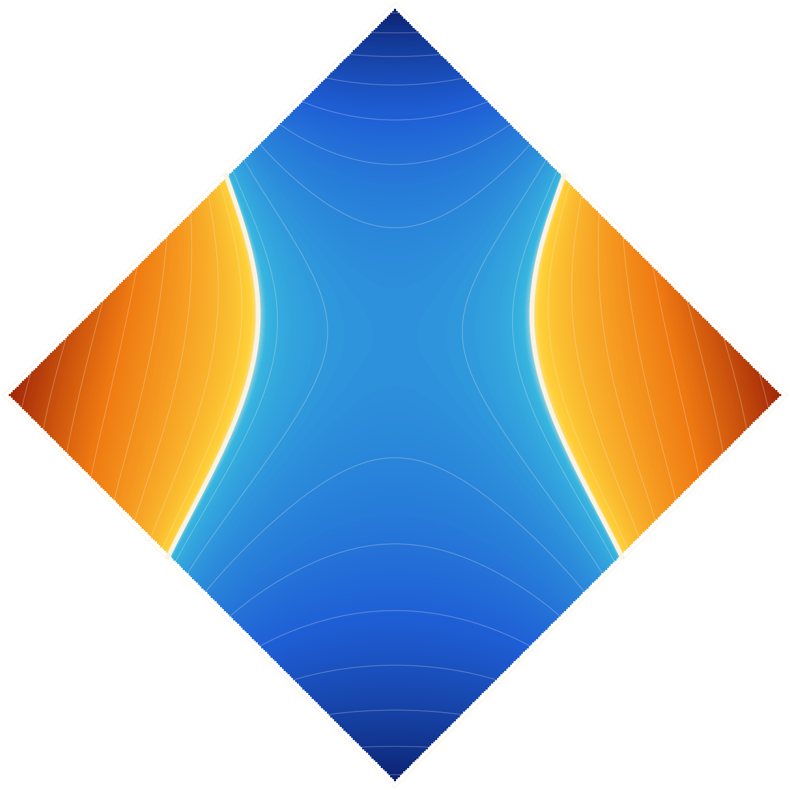
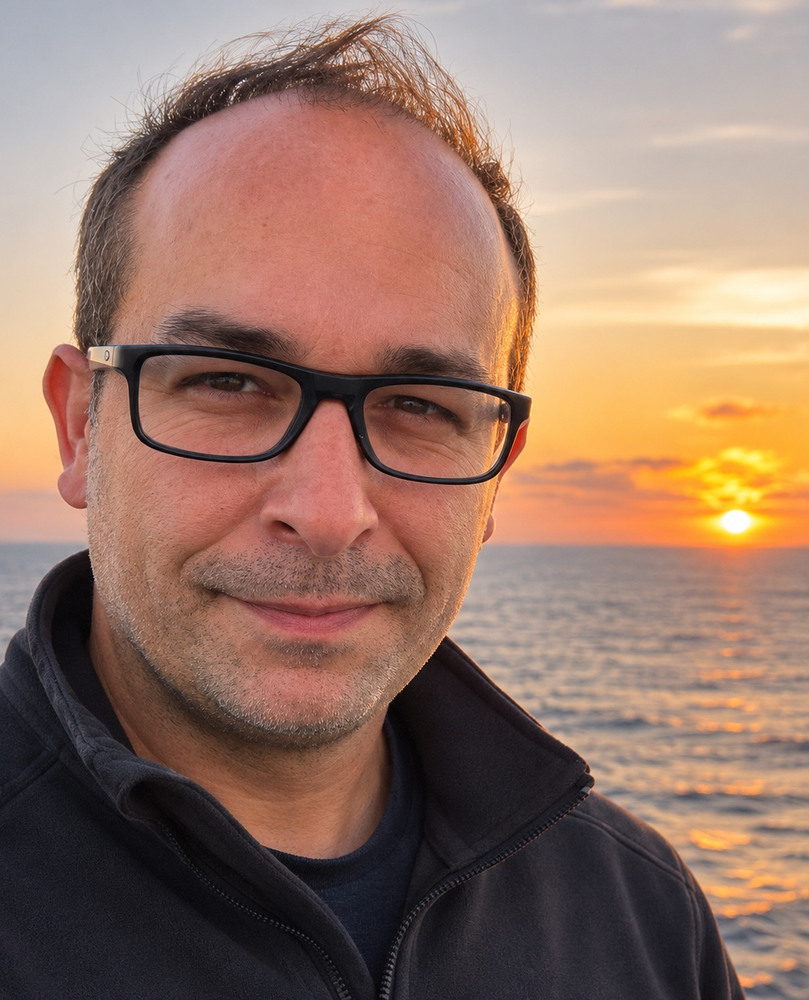

::::::: hero-band

:::::: hero

::: hero-text
[Theoretical & mathematical physics]{.kicker}

# Jose M. Muñoz‑Castañeda

[Profesor Titular · Universidad de Valladolid · IMUVA]{.affiliation}

[At the intersection of quantum field theory, spectral theory, Casimir physics and mathematical physics.]{.lede}

[[Keywords:]{.runin} spectral theory; self-adjoint extensions; heat kernel; Casimir effect; quantum field theory]{.keywords}
:::

::: hero-plate

:::

:::: hero-actions
[[Explore research →](research.qmd)]{.button-primary}
[[Publications →](publications.qmd)]{.text-link}
[[Teaching →](teaching.qmd)]{.text-link}
[[Collaborators →](collaborations.qmd)]{.text-link}
[[Mathematica →](mathematica.qmd)]{.text-link}
[[Outreach →](outreach.qmd)]{.text-link}
::::

::::::

:::::::

::::::: home

<!-- ============ 1. RESEARCH ============ -->

:::::: {.home-section #research-lines}

::::: section-head
::: {}
[[1]{.num} Research]{.kicker}

## The geometry behind quantum phenomena
:::

How singular backgrounds, such as boundaries, point interactions, defects and solitons, shape quantum vacuum observables, and when those observables are mathematically well defined.
:::::

::::: research-lines

::: research-line
[*φ*(*x*)]{.glyph .g1}

### [Quantum field theory](research.qmd#quantum-field-theory)

Quantum vacuum phenomena in singular backgrounds, zero modes and analytically tractable models.
:::

::: research-line
[*ζ*(*s*)]{.glyph .g2}

### [Spectral & operator theory](research.qmd#spectral-and-operator-theory)

Self-adjoint extensions, heat-kernel expansions, spectral zeta functions and functional determinants.
:::

::: research-line
[*E*~0~]{.glyph .g3}

### [Casimir physics](research.qmd#casimir-physics)

Vacuum energies and forces, δ–δ′ interactions, and how geometry decides whether they attract or repel.
:::

:::::

::::::

<!-- ============ SELECTED WORK ============
     To change a paper, edit the four blocks below.
     The first one (class "featured") is shown larger. -->

:::::: {.home-section .selected-work #selected-work}

[[2]{.num} Selected work]{.kicker}

::::: {.work .featured}
::: work-meta
[[1]]{.ref-num}
[Physics Letters B]{.journal}
Article 141137 · Online 2026
[Vacuum interactions]{.topic}
:::

::: work-body
### Localised zero modes enhance massive Casimir interactions

[J. M. Muñoz-Castañeda, I. Cavero-Peláez, G. Sancho-Garrido]{.authors}

[When the fluctuation operator around a background is gapped except for a single localised zero mode, that mode opens a new channel for vacuum interactions, one that decays more slowly than ordinary massive exchange.]{.summary}

:::: links
[[Read the paper ↗](https://doi.org/10.1016/j.physletb.2026.141137)]{.text-link}
::::
:::
:::::

::::: work
::: work-meta
[[2]]{.ref-num}
[Nuclear Physics B]{.journal}
874, 852–876 (2013)
[Boundary conditions]{.topic}
:::

::: work-body
### Attractive and repulsive Casimir vacuum energy with general boundary conditions

[M. Asorey, J. M. Muñoz-Castañeda]{.authors}

[The vacuum energy of scalar fields across all self-adjoint extensions compatible with quantum field theory, and the conditions that decide whether the Casimir force attracts or repels. The map behind the portrait at the top of this page is one slice of the result.]{.summary}

:::: links
[[Read the paper ↗](https://doi.org/10.1016/j.nuclphysb.2013.06.014)]{.text-link}
::::
:::
:::::

::::: work
::: work-meta
[[3]]{.ref-num}
[Letters in Mathematical Physics]{.journal}
105, 523–549 (2015)
[Spectral theory]{.topic}
:::

::: work-body
### QFT over the finite line: heat kernel coefficients, spectral zeta functions and selfadjoint extensions

[J. M. Muñoz-Castañeda, K. Kirsten, M. Bordag]{.authors}

[Heat-kernel coefficients and spectral zeta functions for the full family of self-adjoint extensions of a field on an interval.]{.summary}

:::: links
[[Read the paper ↗](https://doi.org/10.1007/s11005-015-0750-5)]{.text-link}
::::
:::
:::::

::::: work
::: work-meta
[[4]]{.ref-num}
[Physical Review D]{.journal}
91, 025028 (2015)
[Singular interactions]{.topic}
:::

::: work-body
### δ–δ′ generalized Robin boundary conditions and quantum vacuum fluctuations

[J. M. Muñoz-Castañeda, J. Mateos Guilarte]{.authors}

[Two partially transparent plates modelled by δ–δ′ point interactions. The background induces generalised Robin boundary conditions, and the vacuum force between identical plates can be repulsive, attractive or zero, while opposite plates always attract.]{.summary}

:::: links
[[Read the paper ↗](https://doi.org/10.1103/PhysRevD.91.025028)]{.text-link}
::::
:::
:::::

::::::

<!-- ============ 3. ACADEMIC ACTIVITIES ============ -->

:::::: {.home-section .academic-contributions}

::::: section-head
::: {}
[[3]{.num} Academic activities]{.kicker}

## Beyond research papers
:::

A wider view of teaching, collaborative research, computational resources and public engagement.
:::::

::::: contribution-grid

::: contribution
### [Teaching & supervision →](teaching.qmd)

Courses, doctoral supervision, Bachelor's and Master's theses, and selected resources.
:::

::: contribution
### [Scientific collaborations →](collaborations.qmd)

Long-term research partnerships, joint work and scientific networks.
:::

::: contribution
### [Mathematica notebooks →](mathematica.qmd)

Curated demonstrations and reusable scientific material, released only with explicit permissions.
:::

::: contribution
### [Outreach →](outreach.qmd)

Public communication and educational contributions beyond specialist audiences.
:::

:::::

[Academic leadership, university service and CV →](academic-cv.qmd){.text-link}

::::::

<!-- ============ CALL TO ACTION ============ -->

::::: cta
::: {}
[Academic profile]{.kicker}

## Research, teaching & academic service

Explore academic activities, scientific publications and evidence of research leadership.
:::

::: cta-links
[Academic CV →](academic-cv.qmd)
[ORCID ↗](https://orcid.org/0000-0003-4263-0564)
:::
:::::

:::::::
